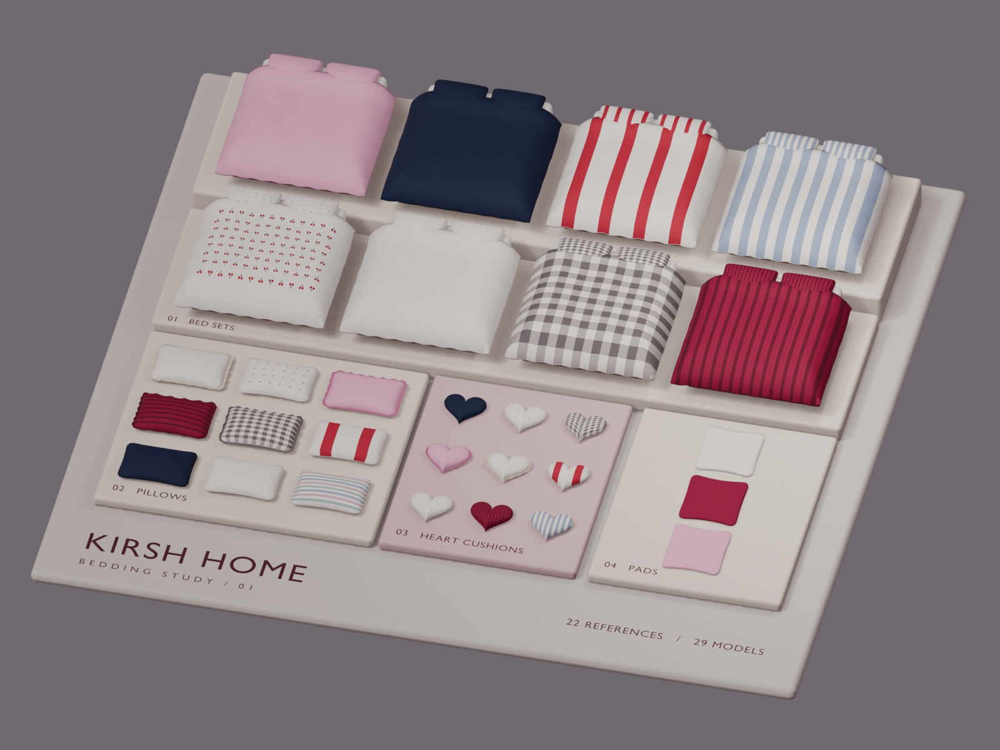

# 키르시홈 침구 3D 미리보기

[`image/`](../image/)의 제품 사진 22장을 바탕으로 만든 쇼룸입니다. 사진에서 보이는 색, 실루엣, 줄무늬, 체크, 체리 무늬, 프릴을 3D 메시와 재질로 근사했습니다. 제품을 회전하거나 크기와 배치를 편집할 수 있습니다.



| 파일 | 용도 |
| --- | --- |
| [Kirsh_Home_Product_Preview.glb](Kirsh_Home_Product_Preview.glb?raw=true) | 내려받아 3D Jutsu 웹 또는 Blender에서 열 수 있는 3D 장면 |
| [build_scene.py](build_scene.py) | Higgsfield MCP에서 편집 가능한 장면을 재현하는 단일 스크립트 |
| [edit_bedding.py](edit_bedding.py) | 기존 쇼룸의 침대 부품 재질 변경과 하트 쿠션 배치 |

| 제품 | 원본 사진 | 3D 모델 |
| --- | ---: | ---: |
| 침대 세트 | 8 | 8 |
| 베개 | 9 | 9 |
| 하트 쿠션 | 2 | 9 |
| 패드 | 3 | 3 |
| **합계** | **22** | **29** |

각 제품 루트의 `source_image` 속성에서 대응하는 원본 경로를 확인할 수 있습니다. `REF-15` 아래의 `HEART-xx` 8개는 한 사진에 담긴 색상별 하트 쿠션입니다.

## 다른 컴퓨터에서 에이전트에 맡기기

Higgsfield MCP가 이미 연결돼 있다면 아래 문장을 에이전트에 붙여넣으세요.

> `https://github.com/highsun9941/AD`의 `product-preview/README.md`를 읽고 `build_scene.py`를 새 비공개 Higgsfield 3D Jutsu 프로젝트에 실행해 줘. 원본 그룹 22개와 제품 모델 29개를 확인하고 마지막 리비전의 3D 미리보기를 열어 줘.

처음 연결할 때는 사용하는 에이전트에서 Streamable HTTP 서버 `https://mcp.higgsfield.ai/mcp`를 등록하고 Higgsfield 계정으로 로그인하세요. [Higgsfield 연결 안내](https://higgsfield.ai/creator-hub/help-center/integrations/what-is-higgsfield-mcp)

**Codex CLI**

```sh
codex mcp add higgsfield --url https://mcp.higgsfield.ai/mcp
```

등록 후 로그인 창이 열리지 않았다면 `codex mcp login higgsfield`를 실행하세요. [Codex MCP 안내](https://developers.openai.com/codex/mcp)

**Claude Code**

```sh
claude mcp add --transport http higgsfield https://mcp.higgsfield.ai/mcp
```

Claude Code에서 `/mcp`를 열고 Higgsfield 연결을 인증하세요.

## MCP 실행 순서

1. `get_preset_instructions`에 `{"preset":"/3d-jutsu"}`를 보내고 `scene_builder_3d_*` 도구가 있는지 확인합니다.
2. `scene_builder_3d_create_project`로 **새 비공개 프로젝트**를 만듭니다. 이후 호출에는 이 프로젝트의 `projectId`를 사용합니다.
3. `scene_builder_3d_get_project`로 진행 중인 작업을 확인한 뒤 `scene_builder_3d_query_python`으로 빈 씬인지 검사합니다. 쿼리 코드는 `result = {"objects": [obj.name for obj in bpy.context.scene.objects]}`입니다. 배열이 비어 있을 때 실행을 진행합니다.
4. `scene_builder_3d_run_python`의 `code`에 [build_scene.py](build_scene.py) 전체를 넣습니다. 직전 쿼리의 `operation.revisionBefore`와 `operation.sceneSequenceAfter`를 각각 `revision`과 `expectedSceneSequence`에 넣고, 이번 작업용 `operationId`를 지정합니다. 스크립트는 외부 파일 없이 장면을 구성합니다.
5. 응답이 진행 중이면 동일한 `projectId`와 `operationId`로 `scene_builder_3d_get_operation`을 확인합니다. `succeeded`의 결과에서 `reference_count: 22`와 `model_count: 29`를 확인한 뒤, `revisionAfter`로 `scene_builder_3d_show_scene`을 호출합니다.

`scene_builder_3d_*` 도구를 사용할 수 없는 클라이언트에서는 GLB를 내려받아 3D Jutsu 웹의 새 장면에 가져오세요. 이 경로는 웹 편집기의 파일 가져오기를 사용합니다. [3D Jutsu 파일 가져오기 안내](https://higgsfield.ai/blog/higgsfield-3d-jutsu)

## 침대 세트 부품 편집

침대 8세트마다 아래 부품을 개별 오브젝트로 선택하고 이동하거나 재질을 바꿀 수 있습니다. **왼쪽과 오른쪽은 침대 발치에서 머리맡을 바라보는 방향**입니다. 체리 무늬는 해당 베개나 이불에 붙어 함께 움직입니다.

| 부품 | `bedding_part` | `REF-01`의 오브젝트 이름 |
| --- | --- | --- |
| 왼쪽 베개 | `pillow_left` | `REF-01 / Left pillow` |
| 오른쪽 베개 | `pillow_right` | `REF-01 / Right pillow` |
| 이불 | `duvet` | `REF-01 / Duvet` |
| 매트리스 | `mattress` | `REF-01 / Mattress` |
| 프레임 | `frame` | `REF-01 / Frame` |
| 프레임 하단 몰딩 | `frame_trim` | `REF-01 / Frame trim` |

에이전트에게는 원본 파일명이나 `REF-xx`를 지정해서 요청하세요.

> `highsun9941/AD`의 침대 세트 부품 편집 절차를 사용해서 `0b4fec116e960bd32069bdeb62c2248a` 세트의 왼쪽 베개를 파란색으로 바꿔 줘.

### 에이전트에서 실행

1. 대상 프로젝트를 `scene_builder_3d_get_project`로 읽고, `scene_builder_3d_query_python`으로 `source_image`와 `bedding_part`를 확인합니다.
2. [edit_bedding.py](edit_bedding.py) 전체에 아래에서 요청에 맞는 호출을 덧붙여 `scene_builder_3d_run_python`에 보냅니다. 위의 MCP 실행 순서와 동일하게 최신 쿼리의 `revisionBefore`와 `sceneSequenceAfter`를 사용합니다.
3. 작업이 끝나면 바뀐 부품을 확인하고 최종 `revisionAfter`로 `scene_builder_3d_show_scene`을 호출합니다.

```python
# 체리 침대의 왼쪽 베개를 파란색으로
result = set_bedding_material("0b4fec116e960bd32069bdeb62c2248a", "pillow_left", "#2459B6")

# 체크 침대의 이불 중앙에 아이보리 하트 쿠션 배치
result = place_center_heart("2cbf9bbe01a737c1a91c7634795f2902")

# 베리 줄무늬 침대의 매트리스만 빨간색으로
result = set_bedding_material("41b4c6a0ac5f05e348c2954fdb926f21", "mattress", "#BF2644")
```

재질은 `#RRGGBB` 색상이나 씬의 정확한 재질 이름으로 지정합니다. 단색으로 바꾸면 선택한 부품의 체리 무늬에도 그 색을 적용합니다. 하트 쿠션은 쇼룸의 원본을 복제해 이불 중앙의 표면 기준점에 놓습니다. 다른 색은 두 번째 인수로 `HEART-01`부터 `HEART-08`까지 지정할 수 있습니다.

이미 만든 쇼룸에 부품 ID가 없다면 같은 방식으로 `result = upgrade_bedding_parts()`를 한 번 실행하세요. 기존 메시의 위치를 유지하면서 이름, 회전 중심, 배치 기준점을 추가합니다. 그다음 다시 쿼리하여 편집 작업의 최신 리비전을 확인하세요.

## Blender에서 편집본 만들기

저장소 루트에서 아래 명령을 실행하면 `product-preview/Kirsh_Home_Product_Preview.blend`가 생성됩니다. 기존 GLB를 Blender로 가져오는 방법도 있습니다.

```sh
blender --background --factory-startup --python-exit-code 1 \
  --python-expr "import bpy; bpy.ops.wm.read_factory_settings(use_empty=True)" \
  --python product-preview/build_scene.py \
  --python-expr "import bpy; bpy.ops.wm.save_as_mainfile(filepath='product-preview/Kirsh_Home_Product_Preview.blend')"
```
